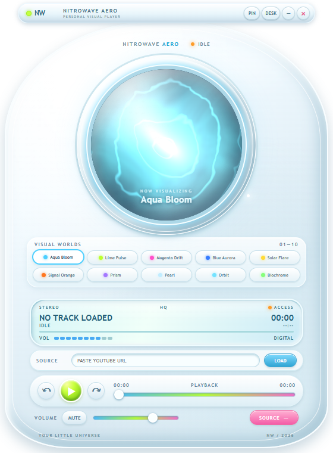
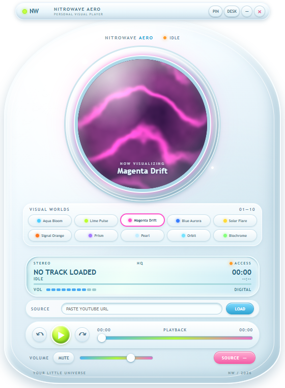
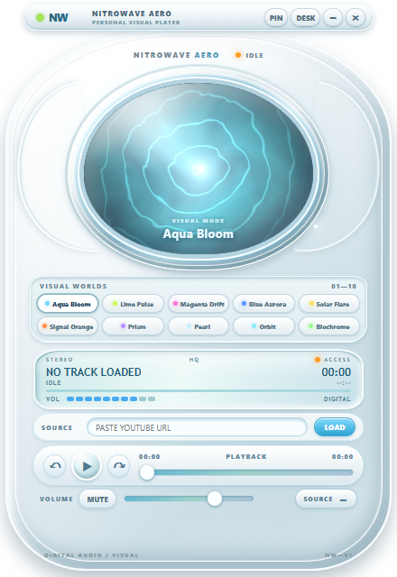

<div align="center">

# Nitrowave Aero

**A compact, skinnable desktop music player with a live WebGL2 visualizer.**

[](https://github.com/ripplewaters/Nitrowave-Aero-1.0/actions/workflows/ci.yml)
[](LICENSE)
[](https://tauri.app)





</div>

Nitrowave Aero is a small Windows music player built with [Tauri 2](https://tauri.app), React and WebGL2. Ten audio-reactive shader worlds react to bass, mids, treble, loudness and detected kicks, and are rendered through a curved CRT-glass pass. Twelve sculpted skins change the shell.

## Features

- **Local music files.** Play audio files on your computer. Analysis runs in the browser with the Web Audio API.
- **Follow other apps (Windows).** Visualize audio from Spotify, a browser or any other app through WASAPI loopback capture, and see its "now playing" metadata through the System Media Transport Controls. Play, pause and skip are sent as media-key commands. Nitrowave never touches another app's stream or account.
- **YouTube links.** Paste a link and it opens in your browser. Nitrowave then follows along through system audio, so the visuals still dance. Nitrowave does not embed or hide YouTube playback, in line with YouTube's API terms.
- **Ten shader worlds**, stepped through with the ← → keys or on-screen buttons.
- **Twelve skins**, and a glow colour that can follow the skin, the shader or a custom colour.
- **Compact and resizable window**, remembered between sessions.

## Install

Pre-built Windows installers will be published on the [Releases](https://github.com/ripplewaters/Nitrowave-Aero-1.0/releases) page. The installer is per-user and does not need administrator rights.

macOS builds are a preview with local-file playback only. See [MACOS.md](MACOS.md).

## Build from source

Requirements:

- [Node.js](https://nodejs.org) 22 (see `.nvmrc`)
- [Rust](https://rustup.rs) stable
- Windows 10 or 11 with [WebView2](https://developer.microsoft.com/microsoft-edge/webview2/) (included in current Windows versions)

```powershell
git clone https://github.com/ripplewaters/Nitrowave-Aero-1.0.git
cd Nitrowave-Aero-1.0
npm ci
npm run tauri:dev       # run the app in development mode
npm run tauri:build     # build the release app and Windows installer
```

Other useful scripts:

| Command | What it does |
| --- | --- |
| `npm test` | Run the unit tests (Vitest) |
| `npm run build` | Typecheck and build the app UI |
| `npm run dev` | Run the UI alone in the browser |
| `npm run landing:dev` | Run the project website locally |
| `npm run landing:build` | Build the project website |
| `npm run notices` | Regenerate `THIRD-PARTY-NOTICES.txt` |

## Project structure

```
src/                 React UI, audio hooks, shader and skin code (TypeScript)
src/player/          Local audio, system audio levels and media-session hooks
src/components/      Shader visual, shell artwork and layout geometry
src/skins/           Skin definitions and CSS
src/landing/         Project website (Vite multi-page app)
src-tauri/src/       Rust backend: WASAPI loopback, SMTC media control, window commands
scripts/             Build, release staging and notices scripts
```

## Architecture notes

- The UI is a single React app. The visuals run in a WebGL2 shader fed by a small set of audio levels (level, bass, mids, treble, kick).
- On Windows, the Rust backend captures system audio with WASAPI loopback and reads "now playing" from the System Media Transport Controls. Both are exposed to the UI as Tauri commands.
- The platform is detected at runtime (`src/player/usePlatformCapabilities.ts`), so features a platform does not support yet are hidden instead of failing.

## Roadmap

- macOS system audio capture (see [MACOS.md](MACOS.md))
- Signed Windows and macOS release builds
- More skins and shader worlds

Ideas and bug reports are welcome in the [issue tracker](https://github.com/ripplewaters/Nitrowave-Aero-1.0/issues).

## Contributing

Contributions are welcome. Please read [CONTRIBUTING.md](CONTRIBUTING.md) first, and follow the [Code of Conduct](CODE_OF_CONDUCT.md).

## Security

To report a vulnerability, please use [private advisory reporting](https://github.com/ripplewaters/Nitrowave-Aero-1.0/security/advisories/new) rather than a public issue. See [SECURITY.md](SECURITY.md).

## Privacy

Nitrowave Aero does not collect, send or store personal data, and makes no network requests of its own. Its settings (volume, skin, window position) are saved locally on your computer.

## Credits

- Fonts: [Audiowide](https://fonts.google.com/specimen/Audiowide), [VT323](https://fonts.google.com/specimen/VT323) and [Orbitron](https://fonts.google.com/specimen/Orbitron), all under the SIL Open Font License, bundled offline through Fontsource.
- Built with [Tauri](https://tauri.app), [React](https://react.dev), [Vite](https://vite.dev) and [Vitest](https://vitest.dev).
- Third-party licences: see [THIRD-PARTY-NOTICES.txt](src-tauri/THIRD-PARTY-NOTICES.txt).

## License

Released under the [MIT License](LICENSE). Copyright (c) 2026 Nitrowave.

"Nitrowave" and "Nitrowave Aero" are names used by the project. The MIT License covers the code; it does not grant trademark rights to the names or logos.
